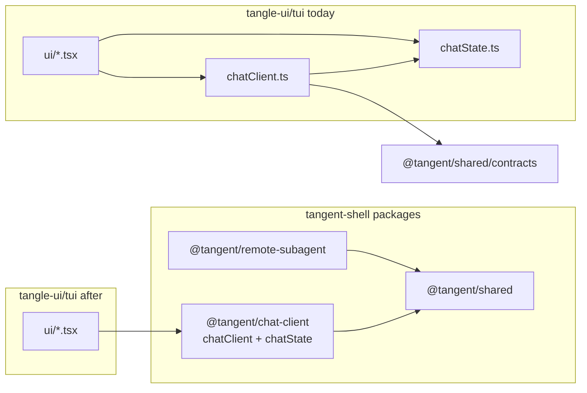

# Extract a `@tangent/chat-client` package to tangent-shell

## Recommendation

Extract **`tui/src/chatClient.ts`** and **`tui/src/chatState.ts`** (plus `tui/src/chatState.test.ts`) into a new tangent-shell workspace package: **`@tangent/chat-client`**.

This is the client half of the Shell chat protocol: it joins a session over Socket.IO, keeps a reducer-style `ChatState` in sync with streamed agent events, and sends human messages. It is the direct counterpart to `@tangent/remote-subagent` (the client for the local-agent-host side), and belongs next to it in tangent-shell.

### Why this exact boundary

- `chatClient.ts` depends only on `@tangent/shared/contracts.ts`, `socket.io-client`, and `./chatState.ts` — no `ink`/React/TUI imports. It is already a clean, framework-agnostic client.
- `chatState.ts` is pure data: `createChatState`, the `withAgent*`/`withHistory`/`withRoster` reducers, and presentation-neutral selectors (`tabInfos`, `workingConversations`). No UI deps.
- The only consumers of these in the TUI are UI files that import *types and selectors* (`ui/ChatScreen.tsx`, `ui/Tabs.tsx`, `ui/SessionStatus.tsx`, `ui/Transcript.tsx`, `ui/App.tsx`) — so extraction is import-path-only for the TUI.

Note: `shellClient.ts`, `session.ts`, `localAgentHost.ts`, and `auth.ts` are **not** part of this. `shellClient.ts`/`session.ts` are REST + Tangent-session orchestration (not WebSocket), and `localAgentHost.ts` already delegates its WebSocket work to the existing `@tangent/local-agent-host` + `@tangent/remote-subagent` packages.

## Current vs proposed

## Package shape (mirror `@tangent/remote-subagent`)

- `packages/chat-client/package.json`:
  - `"name": "@tangent/chat-client"`, `"private": true`, `"type": "module"`, version `0.0.0`.
  - `exports`: `"."` -> `./src/index.ts`, plus `"./*.ts"` and `"./*"` -> `./src/*.ts` (same pattern as remote-subagent).
  - `dependencies`: `@tangent/shared: "workspace:*"`, `socket.io-client: "^4.8.3"`.
  - `devDependencies`: `@tangent/build: "workspace:*"`, `@types/node`, `eslint`, `tsx`, `typescript` (copy from remote-subagent).
  - scripts: `lint`, `test` (`tsx --test "src/**/*.test.ts"`), `typecheck`, `format`; `"prettier": "@tangent/build/prettier"`.
- `src/chatClient.ts` — moved as-is (the `./chatState.ts` relative import is unchanged).
- `src/chatState.ts` — moved as-is.
- `src/chatState.test.ts` — moved as-is.
- `src/index.ts` — re-export the public surface: `ChatClient`, `ChatClientOptions`, `ChatStateListener`, and from chatState: `ChatState`, `ConversationState`, `createChatState`, `tabInfos`, `workingConversations`, `TabInfo`, `TabTone`, `WorkingAgent`, `PRIME_TITLE`.
- `tsconfig.json` + `eslint.config.js` — copy from `packages/remote-subagent`.

## Steps

1. In **tangent-shell**: scaffold `packages/chat-client` from `packages/remote-subagent` (package.json, tsconfig, eslint).
2. Move `chatClient.ts`, `chatState.ts`, `chatState.test.ts` from tangle-ui into `packages/chat-client/src/`; add `src/index.ts` barrel of the public surface above.
3. Run `pnpm install`, then `pnpm --filter @tangent/chat-client typecheck lint test` in tangent-shell; open a tangent-shell PR and merge (the TUI consumes it via `github:TangleML/tangent-shell#main`).
4. In **tangle-ui/tui**: add the dependency to `tui/package.json` `dependencies` and the `pnpm.overrides` block, mirroring the other three:
   `"@tangent/chat-client": "github:TangleML/tangent-shell#main&path:packages/chat-client"`.
5. Delete `tui/src/chatClient.ts`, `tui/src/chatState.ts`, `tui/src/chatState.test.ts`.
6. Repoint TUI imports to the package:
   - `../chatClient.ts` -> `@tangent/chat-client` in `ui/App.tsx`, `ui/ChatScreen.tsx`.
   - `../chatState.ts` -> `@tangent/chat-client` in `ui/ChatScreen.tsx`, `ui/Tabs.tsx`, `ui/SessionStatus.tsx`, `ui/Transcript.tsx`.
7. `pnpm install`, then `pnpm typecheck`, `pnpm lint`, `pnpm test`, `pnpm build` in `tui/` to confirm the bundle still builds.

## Notes / decisions

- Name chosen: `@tangent/chat-client` (parallels `@tangent/remote-subagent`). Easy to rename before scaffolding if you prefer e.g. `@tangent/shell-chat-client`.
- Cross-repo ordering: because the TUI pulls tangent-shell packages from `#main`, the tangent-shell PR must land before the tangle-ui import switch (step 3 before 4-7).
- The presentation selectors (`tabInfos`, `workingConversations`, `PRIME_TITLE`) are kept in the package since they are UI-framework-neutral and a web client would want them too; the actual React/ink rendering stays in tangle-ui.
